# 📦 Controle de Estoque por EAN

**Sistema web de controle de estoque para e-commerce: bipou, baixou.**
Entradas e saídas por código de barras, kits virtuais, estorno com motivo, ranking do que mais sai e inventário por bipagem. Roda num computador da própria empresa, **sem mensalidade e sem hospedagem**.

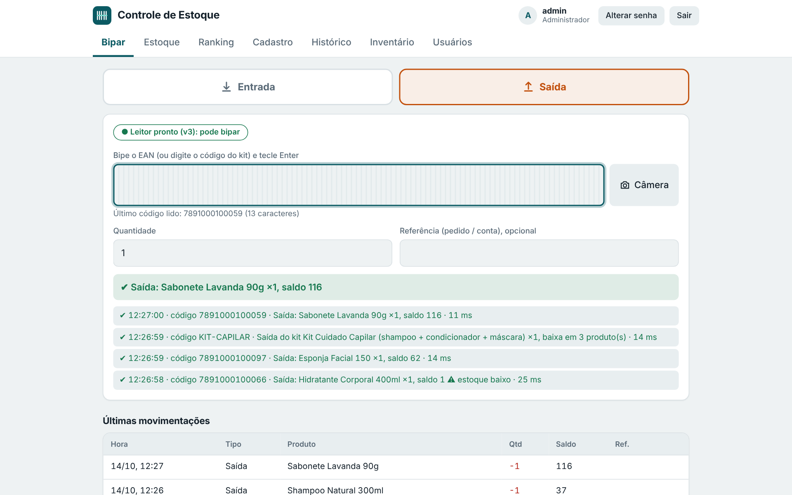

> Projeto criado por um estudante de Análise e Desenvolvimento de Sistemas para resolver um problema real: o estoque de uma loja que vende em vários marketplaces. As imagens deste repositório são capturas reais do sistema, com **dados de demonstração** (produtos fictícios).

---

## O problema

- Fazer inventário completo para saber o saldo real **para a operação e toma muito tempo**.
- O mesmo produto é vendido avulso e em **kits** (ex.: shampoo + condicionador + máscara). Quando o kit sai, ninguém lembra de baixar cada componente, e o saldo desencontra.
- Em planilha, qualquer erro de digitação ou baixa esquecida passa despercebido, e **não se sabe quem mexeu**.
- Falta visão de **quanto dinheiro está parado** em estoque e **o que mais sai**.

## A solução, em uma frase

Cada produto tem um **EAN**. Quem separa o pedido **bipa o código de barras**, e o sistema atualiza o saldo na hora, registra quem fez e avisa quando algo está acabando.

## Como funciona

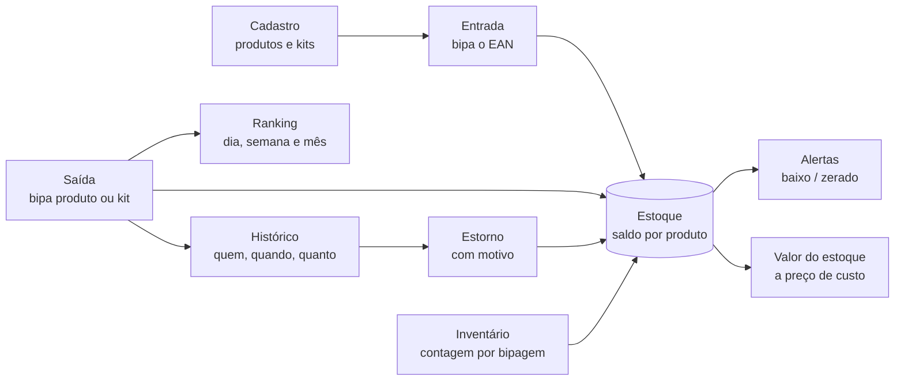

1. **Cadastre** os produtos (EAN, nome, localização, estoque mínimo, preço de custo) e os kits (a lista de componentes).
2. **Dê entrada** bipando o EAN quando a mercadoria chega.
3. **Dê saída** bipando o produto, ou o **código do kit**: o sistema baixa cada componente de uma vez. Se faltar saldo em algum, **nada é baixado**.
4. **Acompanhe**: saldo, produtos acabando, valor em estoque e ranking do que mais sai.
5. **Corrigiu um erro?** O administrador **estorna** o lançamento informando o motivo. O original fica no histórico, riscado.
6. **Confira o físico** com o inventário por bipagem, que mostra as diferenças e ajusta o saldo.

O leitor de código de barras USB funciona como um teclado: não precisa instalar driver.

## Benefícios

| Antes | Com o sistema |
|---|---|
| Inventário completo para saber o saldo | Saldo sempre atualizado a cada bipe; inventário só para conferir |
| Kit sai e ninguém baixa os componentes | Bipou o kit, **todos os componentes são baixados** |
| Erro de digitação em planilha | O leitor lê o EAN; o servidor **recusa saída sem saldo** |
| Não se sabe quem mexeu | Cada lançamento guarda **usuário, data e hora** |
| Erro irreversível ou apagado sem rastro | **Estorno com motivo obrigatório**; nada é apagado |
| Não se vê o dinheiro parado | **Valor do estoque a preço de custo** e onde ele está concentrado |
| Descobre que acabou quando o cliente compra | **Alertas** de estoque baixo e zerado |
| Não se sabe o que mais vende | **Ranking** do dia, da semana e do mês |
| Custo de ferramenta e hospedagem | **Gratuito**, roda num computador da empresa, na rede local |

---

## Conheça as telas

### Login

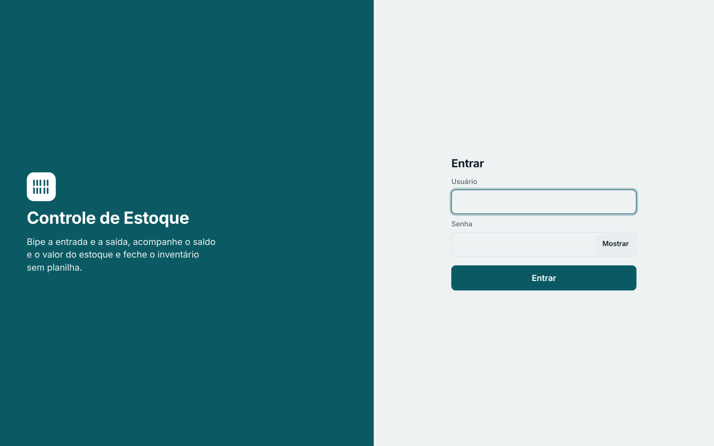

Entrada com usuário e senha (com botão de mostrar/ocultar). Há dois perfis: **administrador**, que faz tudo, e **operador**, que bipa e consulta.

### Bipar: entrada e saída


O coração do sistema. Escolha **Entrada** ou **Saída**, bipe o código e pronto. O leitor mostra se está pronto, cada bipe aparece na lista com o resultado (aceito ou recusado e por quê) e a quantidade, e o campo **Referência** guarda o número do pedido. Bipes rápidos em sequência são processados **em ordem, sem perder nenhum**, e saída acima do saldo é bloqueada.

### Kits virtuais

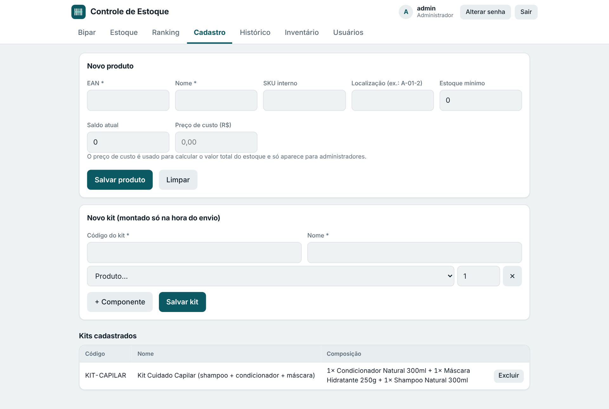

O kit **não tem saldo próprio**: é só uma receita. Ao bipar o código do kit na saída, o sistema baixa cada componente de uma vez (tudo ou nada). Assim o saldo de cada produto continua certo, vendido avulso ou em kit. O cadastro também guarda o **preço de custo**, visível só para o administrador.

### Estoque e valor total

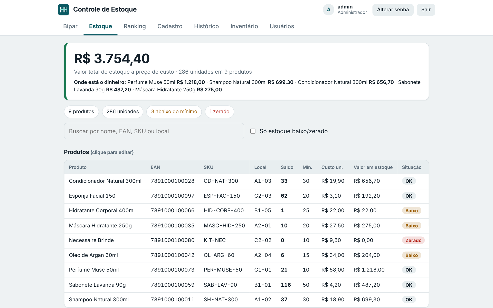

Saldo de cada produto com busca por nome, EAN, SKU ou local, **alertas** (OK, Baixo, Zerado), quantos kits ainda dá para montar e exportação em CSV. O quadro do topo mostra **quanto vale o estoque a preço de custo** e **onde está o dinheiro** (administrador).

### Ranking: o que mais sai

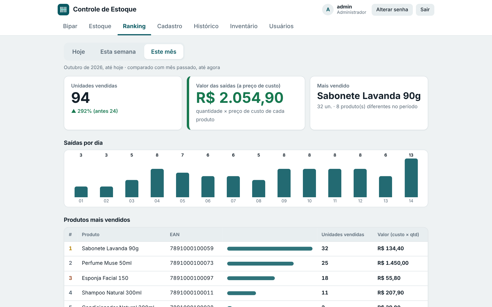

Aba com **Hoje, Esta semana e Este mês**. Mostra as unidades vendidas comparadas ao período anterior (no mesmo trecho de tempo), o produto mais vendido, o gráfico de saídas por dia e o ranking de produtos. O administrador vê também o **valor das saídas a preço de custo** (quantidade × custo). Cada produto bipado como saída entra no ranking, e saída estornada não conta.

### Histórico e estorno

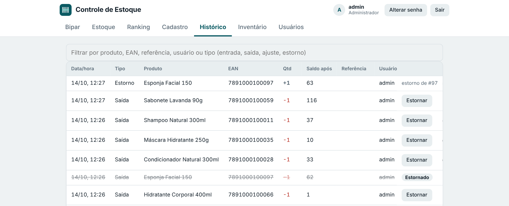

Toda movimentação fica registrada com data, produto, quantidade, saldo após, referência e **usuário**. O administrador pode **estornar** uma entrada ou saída informando o motivo:

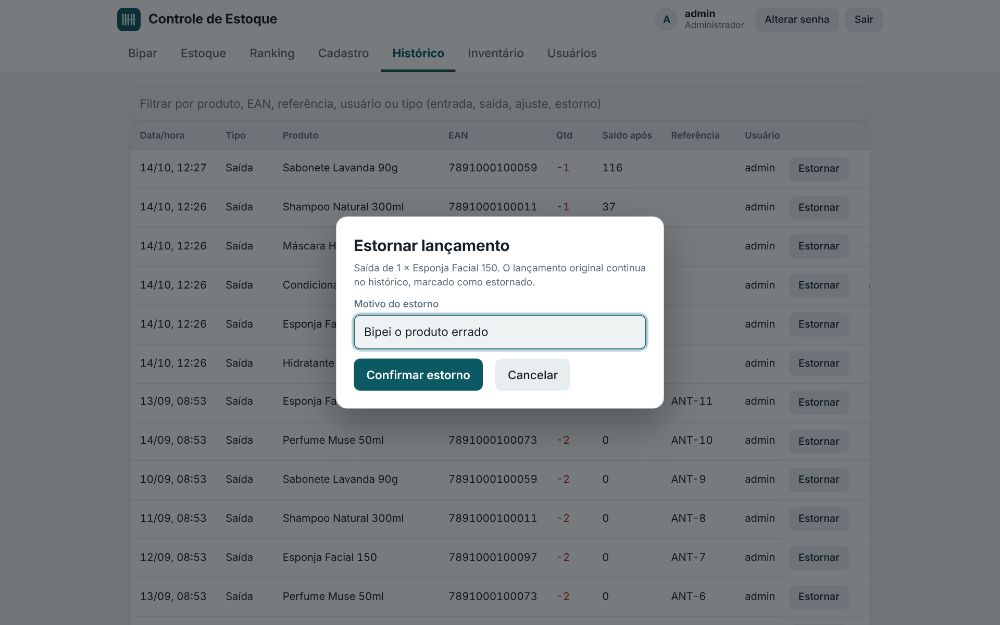

O estorno gera um novo lançamento ligado ao original, que continua no histórico, riscado e marcado como **Estornado**. Um kit é estornado por inteiro.

### Inventário por bipagem

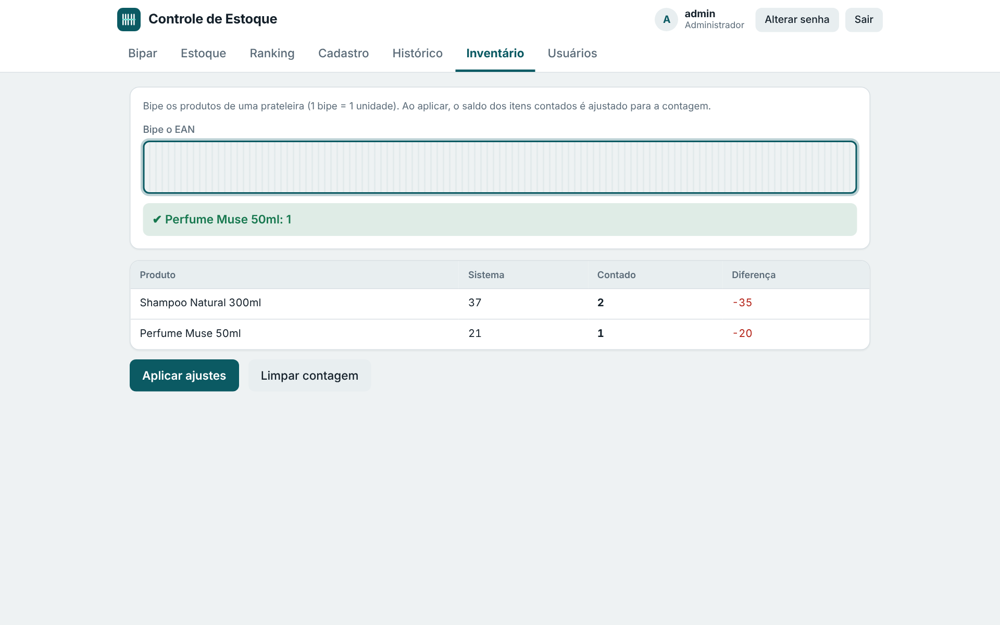

Bipe os produtos de uma prateleira (1 bipe = 1 unidade). O sistema compara a contagem com o saldo, mostra a **diferença** e, ao aplicar, ajusta o saldo, registrando tudo no histórico.

### Usuários e senhas

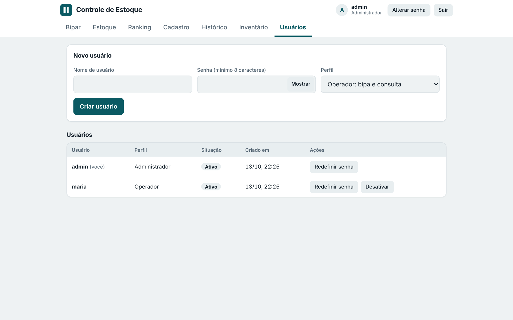

O administrador cria usuários, redefine senhas e desativa acessos. Cada pessoa troca a própria senha pela tela.

### No celular e no modo escuro

| Celular | Modo escuro |
|---|---|
| 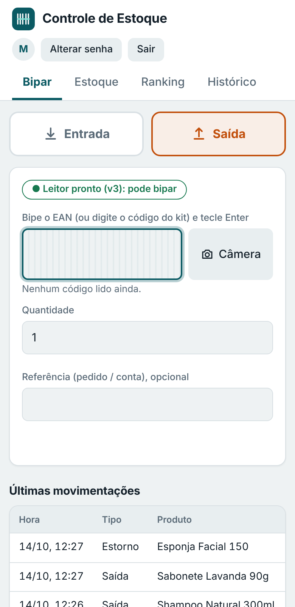 | 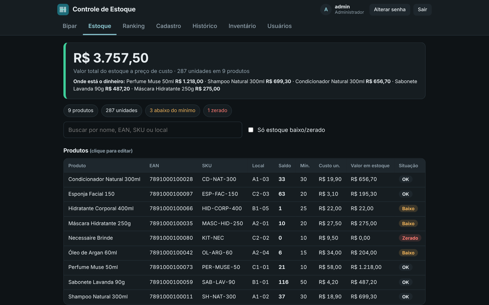 |

O sistema abre no navegador de qualquer aparelho da rede, sem instalar aplicativo. O tema claro ou escuro acompanha a configuração do aparelho. Opcionalmente, com HTTPS na rede interna, dá para **bipar com a câmera do celular** (veja [docs/https-celular.md](docs/https-celular.md)).

---

## Funcionalidades

- **Bipar** entrada e saída por EAN, com som de confirmação e de erro.
- **Kits virtuais** com baixa tudo-ou-nada dos componentes.
- **Estoque** com busca, localização, estoque mínimo, alertas e exportação em CSV.
- **Preço de custo** e valor total do estoque (somente administrador).
- **Ranking** de saídas por dia, semana e mês, com comparação com o período anterior.
- **Histórico** completo com usuário, e **estorno com motivo**.
- **Inventário** por bipagem, com conferência e ajuste.
- **Usuários e perfis** (administrador e operador) com permissões validadas no servidor.
- **Backup automático** diário, com as últimas cópias guardadas.
- **Início automático com o Windows** e scripts `.bat` para iniciar e parar.
- **Leitura por câmera** (opcional, com HTTPS na rede interna).

## O que este projeto demonstra

Pensado também como projeto de estudo, ele mostra na prática:

- **API REST** feita só com módulos nativos do Node.js (`http`, `crypto` e `node:sqlite`), sem framework e sem `npm install`.
- **Modelagem de dados** relacional com SQLite, migrações que atualizam o banco existente sem perder dados e **transações** (`BEGIN IMMEDIATE`) para que bipes simultâneos não corrompam o saldo.
- **Regras de negócio** no servidor: saldo nunca negativo, kits tudo-ou-nada, estorno rastreável, dinheiro guardado em **centavos inteiros** (sem erro de ponto flutuante).
- **Autenticação e autorização**: senhas com scrypt, token JWT (HS256), perfis, bloqueio após tentativas erradas e validação de toda entrada.
- **Front-end sem framework**: HTML, CSS e JavaScript puro, com tema claro/escuro automático e layout responsivo.
- **Testes automatizados** das regras de negócio, da API, das permissões, do backup e do leitor de código de barras.
- **Implantação real**: servidor local, início automático no Windows, backup e HTTPS opcional.

## Tecnologias

- **Front-end:** HTML, CSS e JavaScript puro.
- **Back-end:** Node.js 22.13 ou superior, só com módulos nativos.
- **Banco de dados:** SQLite (um único arquivo, modo WAL).
- **Testes:** `node:test`, o executor de testes nativo do Node.

## Como rodar

1. Instale o [Node.js](https://nodejs.org) (versão LTS, 22.13 ou superior).
2. Abra o terminal na pasta `backend`.
3. Crie o administrador (troque a senha) e inicie o servidor:
   ```bash
   npm run criar-usuario -- admin SUA-SENHA admin
   npm start
   ```
4. O terminal mostra os endereços. No próprio computador use `http://localhost:3000`; nos outros aparelhos da rede, o endereço "Na rede da empresa" (ex.: `http://192.168.0.10:3000`).
5. Crie os demais usuários quando quiser, pela aba **Usuários** ou pelo terminal:
   ```bash
   npm run criar-usuario -- maria SENHA-DA-MARIA operador
   ```

Passo a passo completo para Windows (firewall, IP fixo, início automático e backup) em [docs/implantacao.md](docs/implantacao.md).

## Testes

```bash
cd backend
npm test
```

## Estrutura do projeto

```
controle-estoque/
├── frontend/
│   ├── index.html
│   ├── css/style.css
│   └── js/              # api, bipar, estoque, ranking, cadastro, histórico, inventário, usuários, câmera, main...
├── backend/
│   ├── src/
│   │   ├── server.js    # ponto de entrada
│   │   ├── app.js       # rotas, autenticação e permissões
│   │   ├── estoque.js   # regras de negócio (saldo, kits, estorno, ranking)
│   │   ├── usuarios.js  # usuários e perfis
│   │   ├── auth.js      # senha (scrypt) e token (JWT)
│   │   ├── db.js        # SQLite, tabelas, migrações e transações
│   │   ├── backup.js    # backup automático
│   │   ├── http.js      # roteador, JSON e arquivos estáticos
│   │   ├── config.js    # variáveis de ambiente
│   │   └── errors.js
│   ├── scripts/         # criar-usuario, alterar-senha, backup, gerar-certificado
│   ├── tests/
│   ├── .env.example
│   └── package.json
├── docs/                # requisitos, modelo de dados, implantação, HTTPS e imagens
└── *.bat, *.vbs, *.ps1  # iniciar, parar e iniciar com o Windows
```

## API

Todas as rotas (exceto login, `/api/saude` e `/estoque-ca.crt`) exigem `Authorization: Bearer <token>`.

| Método e rota | Perfil | Descrição |
|---|---|---|
| `POST /api/auth/login` | público | entrar (devolve o token) |
| `GET /api/auth/eu` | todos | dados do usuário logado |
| `POST /api/auth/senha` | todos | o usuário troca a própria senha |
| `GET /api/produtos` | todos | listar produtos (custo e valor só para admin) |
| `POST /api/produtos` | admin | criar produto |
| `PUT /api/produtos/:ean` | admin | editar produto (alterar saldo gera ajuste) |
| `DELETE /api/produtos/:ean` | admin | excluir (bloqueado se estiver em kit) |
| `GET /api/resumo` | todos | totais do estoque; valor em R$ só para admin |
| `GET /api/ranking?periodo=` | todos | ranking de saídas: `hoje`, `semana` ou `mes` (custo só para admin) |
| `GET /api/kits` | todos | listar kits |
| `POST /api/kits` | admin | criar kit |
| `DELETE /api/kits/:codigo` | admin | excluir kit |
| `POST /api/movimentacoes` | todos | entrada/saída de produto ou saída de kit |
| `GET /api/movimentacoes` | todos | histórico (`?limite=` e `?busca=`) |
| `POST /api/movimentacoes/:id/estorno` | admin | estorna uma entrada ou saída (corpo: `{motivo}`) |
| `POST /api/inventario` | admin | aplicar contagem |
| `GET /api/usuarios`, `POST /api/usuarios` | admin | listar e criar usuários |
| `PUT /api/usuarios/:id/senha` | admin | redefinir a senha de outro usuário |
| `PUT /api/usuarios/:id/ativo` | admin | ativar ou desativar um usuário |

## Documentação

- [Requisitos](docs/requisitos.md)
- [Modelo de dados](docs/modelo-de-dados.md)
- [Implantação no Windows](docs/implantacao.md)
- [HTTPS e câmera do celular](docs/https-celular.md)

## Dados e segurança do repositório

Este repositório **não contém dados reais, senhas, chaves nem certificados**. O banco de dados, o arquivo `.env`, o segredo do login, os backups e os certificados ficam fora do Git (veja o `.gitignore`). Use o `backend/.env.example` como modelo.

## Limitações e próximos passos

- Por padrão a conexão é HTTP dentro da rede da empresa; o HTTPS opcional protege a senha. Use Wi-Fi protegido e senhas fortes.
- O computador servidor precisa ficar ligado durante o uso. O backup automático grava cópias diárias; vale guardá-las em pasta sincronizada com a nuvem.
- Controle apenas interno: **sem integração** com os marketplaces.

Ideias para as próximas versões:

- [ ] Conferência de pedidos importando a planilha do marketplace
- [ ] Painel de vendas e giro de estoque
- [ ] Lista de reposição (produtos abaixo do mínimo, com custo da compra)
- [ ] Preço de venda, faturamento e margem no ranking
- [ ] Impressão de etiquetas de código de barras

## Licença

MIT. Veja o arquivo [LICENSE](LICENSE).
