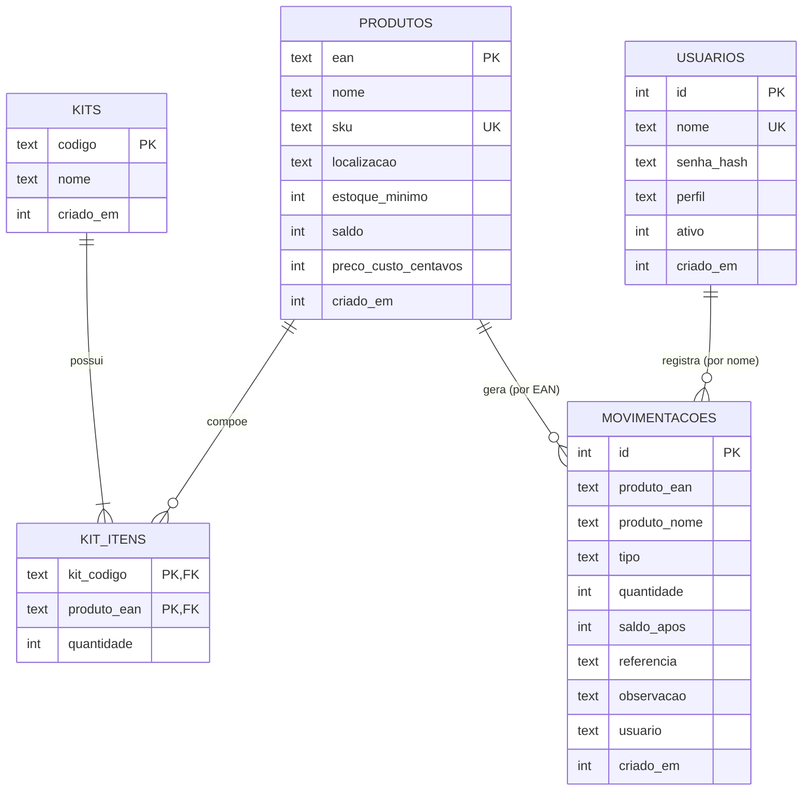

# Modelo de dados

Banco **SQLite** (arquivo `backend/data/estoque.db`). As tabelas são criadas automaticamente na primeira execução (`backend/src/db.js`). O modelo é compatível com PostgreSQL com pequenos ajustes de tipo, caso o projeto migre no futuro.

## Diagrama entidade-relacionamento

## Decisões de modelagem

- **Saldo nunca negativo (RN01):** garantido por `CHECK (saldo >= 0)` no banco e validado antes no serviço, com mensagem clara.
- **Preço de custo em centavos inteiros:** `preco_custo_centavos` evita erros de arredondamento. O valor do estoque é `SUM(saldo × preco_custo_centavos)`. Bancos antigos recebem a coluna automaticamente ao iniciar o servidor (migração).
- **Kit sem saldo próprio (RN02):** `kits` e `kit_itens` guardam só a composição; o saldo de cada kit é calculado pelos componentes.
- **Baixa de kit em transação (RN03):** a saída de um kit baixa todos os componentes dentro de uma única transação (`BEGIN IMMEDIATE ... COMMIT`). Se qualquer componente falhar, nada é gravado.
- **Histórico independente:** `movimentacoes` guarda o EAN e uma cópia do nome do produto (sem chave estrangeira). Assim o histórico continua legível mesmo se o produto for excluído.
- **Unicidade (RN04):** `ean` é chave primária; `sku` é único sem diferenciar maiúsculas (`COLLATE NOCASE`). Produtos sem SKU guardam `NULL`.
- **Código de kit x produto (RN05):** a regra envolve duas tabelas e por isso é verificada no serviço (`estoque.js`), não por restrição do banco.
- **Datas:** guardadas como milissegundos desde 1970 (`criado_em`), convertidas para o horário local na tela.
- **Senhas:** nunca em texto puro; guarda-se `scrypt$sal$hash` em `senha_hash`.

## Tipos de movimentação

| Tipo | Quando ocorre | Quantidade |
|---|---|---|
| `entrada` | bipagem de entrada ou saldo inicial do produto | positiva |
| `saida` | bipagem de saída (produto ou componente de kit) | negativa |
| `ajuste` | edição manual do saldo no cadastro | positiva ou negativa |
| `inventario` | aplicação de contagem de inventário | positiva ou negativa |

## Estorno (movimentacoes)
- `grupo` (TEXT): agrupa as linhas de uma mesma saída de kit.
- `estorno_de` (INTEGER): no lançamento de estorno, id do original.
- `estornado_por` (INTEGER): no original, id do lançamento que o estornou.
