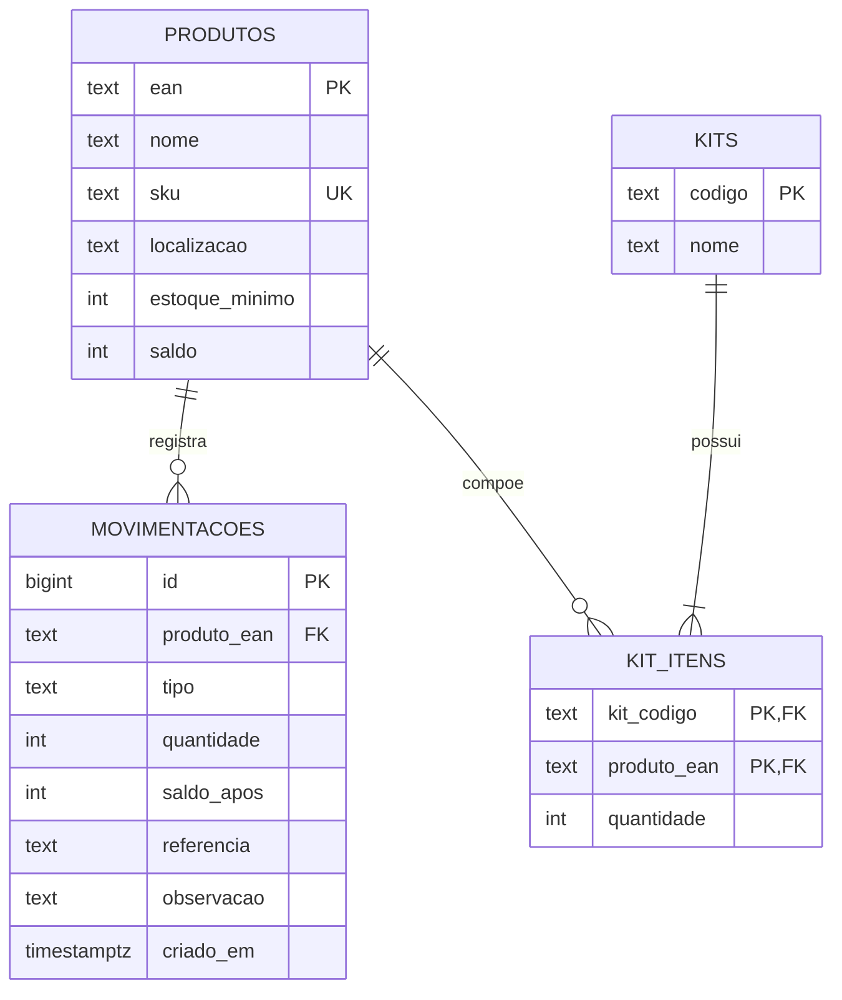

# Modelo de dados

Modelo previsto para a versão com banco de dados (PostgreSQL). Hoje os mesmos dados são guardados como objetos JSON no `localStorage`.

## Diagrama entidade-relacionamento



## Script SQL (PostgreSQL)

```sql
create table produtos (
  ean            text primary key,
  nome           text not null,
  sku            text unique,
  localizacao    text,
  estoque_minimo int  not null default 0 check (estoque_minimo >= 0),
  saldo          int  not null default 0 check (saldo >= 0),
  criado_em      timestamptz not null default now()
);

create table kits (
  codigo text primary key,
  nome   text not null
);

create table kit_itens (
  kit_codigo  text not null references kits(codigo) on delete cascade,
  produto_ean text not null references produtos(ean),
  quantidade  int  not null check (quantidade > 0),
  primary key (kit_codigo, produto_ean)
);

create table movimentacoes (
  id          bigserial primary key,
  produto_ean text not null references produtos(ean),
  tipo        text not null check (tipo in ('entrada','saida','ajuste','inventario')),
  quantidade  int  not null,           -- positivo soma, negativo subtrai
  saldo_apos  int  not null,
  referencia  text,                    -- pedido ou conta
  observacao  text,
  criado_em   timestamptz not null default now()
);

create index on movimentacoes (produto_ean, criado_em desc);
```

## Observações

- A regra RN01 (saldo não negativo) é garantida pelo `check (saldo >= 0)`.
- A baixa de kit deve ocorrer em **uma única transação**: diminuir o saldo de todos os componentes e gravar as movimentações, ou nada (RN03).
- Nos dados atuais (JSON), `produtos` usa `ean` como chave, `kits` usa `codigo` e as movimentações ficam numa lista, da mais recente para a mais antiga.
